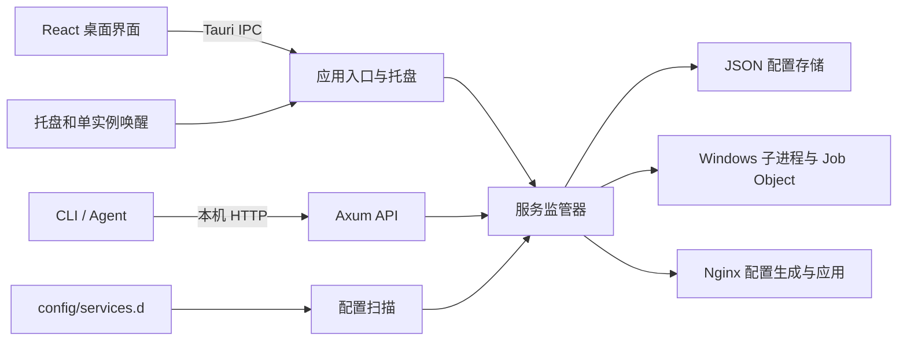

# FlashManager 架构

守饭人由 Windows 托盘常驻进程和按需创建的 WebView2 主窗口组成。Rust 守护进程持有服务状态，桌面 UI、CLI、Agent HTTP 和配置投递都通过它更新服务。

## 组件与边界

| 位置 | 职责 |
| --- | --- |
| [src/startup.ts](../src/startup.ts)、[src/App.tsx](../src/App.tsx) | 启动骨架接管，以及桌面界面的状态、轮询和操作编排。 |
| [src/components/](../src/components/)、[src/features/services/](../src/features/services/)、[src/ProxyPage.tsx](../src/ProxyPage.tsx) | 窗口导航与浮层、服务卡片和详情、服务表单及反代页面。 |
| [src/styles.css](../src/styles.css) | 按层叠顺序加载 `src/styles/` 中各界面的样式。 |
| [src/api.ts](../src/api.ts)、[vite.config.ts](../vite.config.ts) | 桌面 IPC 封装和浏览器开发预览。Vite 的同源开发代理在服务端加入令牌。 |
| [src-tauri/src/lib.rs](../src-tauri/src/lib.rs) | 数据根目录、窗口生命周期、系统托盘、单实例与 IPC 命令。 |
| [supervisor.rs](../src-tauri/src/supervisor.rs)、[job_object.rs](../src-tauri/src/job_object.rs) | 子进程启停、配置与运行状态、日志、资源及端口采集。 |
| [storage.rs](../src-tauri/src/storage.rs)、[detector.rs](../src-tauri/src/detector.rs) | JSON 持久化与备份、路径探测及稳定服务 ID。 |
| [agent_api.rs](../src-tauri/src/agent_api.rs)、[cli.rs](../src-tauri/src/cli.rs)、[proxy.rs](../src-tauri/src/proxy.rs) | 回环 HTTP、控制台客户端、Nginx 反向代理。 |

## 主窗口与后台生命周期

- 首次启动和托盘重建都先隐藏主窗口。`index.html` 提供随本地主题变化的静态骨架，`startup.ts` 通知 Rust 显示窗口，给骨架留出绘制机会，再加载 React。未收到就绪信号时，Rust 在约 3 秒后兜底显示。
- 点击窗口关闭或选择「休眠到系统托盘」会销毁主窗口。托盘左键与「打开」菜单恢复现有窗口，或创建新的 WebView。等候骨架时的重复打开请求不会让空窗口提前显示。
- Windows 命名互斥体限制同一会话的实例数。第二次启动会请求 `POST /api/v1/focus` 唤醒现有进程。托盘的「彻底退出并清理子进程」停止全部服务并退出。

## 服务、日志与反代

- 运行器支持 EXE、Nginx、Node.js、Python、PowerShell 和批处理。子进程使用 `CREATE_NO_WINDOW`，优先通过 Job Object 管理进程树。生命周期操作按服务串行化，手动停止会推进代际，使先前安排的自动重启失效。
- 服务非零退出会进入 `error`，开启自动重启时约 1.5 秒后尝试拉起。运行期间保存新配置会更新持久化记录，启动参数仍以当前运行实例为准，界面据此标记「待重启」。
- 每个服务最多保留 2,000 行内存日志。快照和增量日志独立读取。资源采样约每 2 秒刷新，端口探测在锁外进行。界面可见时约每秒轮询，快照失败时退避。
- 反代规则绑定受管 Nginx 网关和服务。预览生成的配置后，可应用到主配置所在目录的 `flash-manager/routes.conf`，由主配置中的 include 引入。`nginx -t` 失败时尝试回滚。通过检查后，运行中的网关会尝试重载，重载错误单独报告。

## 数据与接入

本机部署使用 `runtime/` 作为数据根目录。便携程序使用 EXE 所在目录。从仓库的 Cargo `target/debug` 或 `target/release` 启动时，桌面端和 CLI 优先使用 `runtime/config/`。旧项目尚未迁移时，回退读取已有的根目录 `config/`。Vite 开发预览与 Agent 注册脚本采用同样的配置优先顺序。

| 路径 | 用途 |
| --- | --- |
| `config/services.json` | 服务配置。守护进程启动时恢复登记记录。 |
| `config/services.d/*.json` | Agent 投递目录，约每 1.5 秒扫描。首次扫描和文件变更会重新登记，按字段选择是否启动。 |
| `config/proxies.json` | 反代规则。保存规则和应用到 Nginx 是两个动作。 |
| `config/*.json.bak` | 上次有效的配置副本。JSON 写入使用临时文件与替换，并拒绝覆盖无法解析的原文件。 |
| `config/agent.token` | 回环 API 的 Bearer Token。 |
| `flashmanager-error.txt` | 关键启动错误，例如 API 监听端口冲突。 |

HTTP 只绑定 `127.0.0.1:19527`。API、CLI 和离线投递方式见 [Agent 接入与排障](../AGENT-INTEGRATION.md)，视觉规范见 [前端设计](design.html)。

## 当前维护边界

- `services.d` 仍会在重启后重放已有清单，应用层删除和清单保留之间需要明确协调。
- 资源刷新在锁外探测后仍按服务列表下标回填。若期间增删服务，指标可能错位。
- 日志容量按行数限制。读流尚未按进程代际隔离，也没有单行字节上限。
